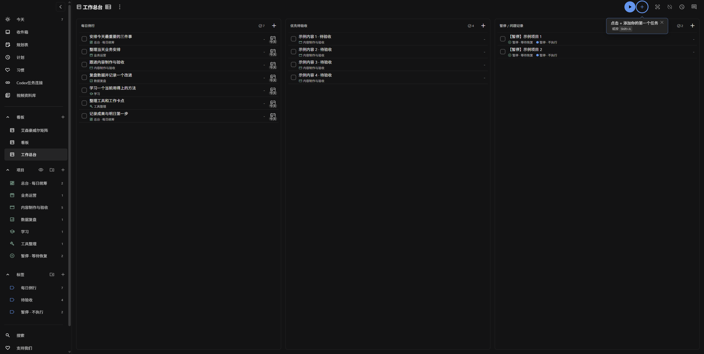

# 工作总台 · 中文版


基于 [Super Productivity](https://github.com/super-productivity/super-productivity) 的本地工作台：**首次打开默认中文、业务项目和任务看板直接可用，Codex 可以连接同一份任务清单。**

适合把每日安排、内容验收、学习和工具整理放到一个入口的人。无需购买 API，也不依赖云端数据库。



## 功能

- 默认简体中文，补齐原中文包缺失条目。
- 每日例行、优先待验收、暂停事项三栏看板。
- 每日统筹、业务运营、内容制作、数据复盘、学习、工具整理等项目。
- 规划表、日程、习惯、专注模式、项目笔记。
- 本地资料库入口，可编辑成自己的链接页。
- Codex MCP：读取项目、标签与任务，创建、修改、完成任务。
- 暂停项目锁定；MCP 没有删除和系统命令接口。

仓库仅附合成演示数据：7项日常安排、4项待验收、2项暂停示例。没有作者的业务清单、素材、账号、浏览器数据或连接令牌。

## 启动

需要 Python 3.10 或更高版本，**无需 pip 安装依赖**。下载仓库 ZIP 并解压，或运行：

```bash
git clone https://github.com/jgtcybf-max/work-console-cn.git
cd work-console-cn
python install.py
python serve.py
```

打开 <http://127.0.0.1:18765/>。Windows 也可以双击 `start.cmd`，用系统默认浏览器打开。

首次安装需要联网，从官方网页发行源获取约22MB资源。安装脚本核对882项资源的原始SHA-1及6个补丁的前后摘要，版本不匹配即停止。输出的 `web/` 是生成目录，不提交Git。仓库不重新分发完整上游编译包。

`18765` 端口已占用时，可设置 `WORK_CONSOLE_PORT`；服务和 MCP 必须使用相同的值。例：PowerShell 运行 `$env:WORK_CONSOLE_PORT='18766'` 后启动服务。

## 连接 Codex

先启动服务并打开页面。左侧应有“Codex任务连接”和“视频资料库”。在终端注册本地 MCP，路径换成自己的实际路径：

```bash
codex mcp add tao-work-console -- python /absolute/path/work-console-cn/codex_mcp.py
```

Windows 示例使用 `C:/code/work-console-cn/codex_mcp.py`。如果 `python` 不在客户端 PATH，换成 Python 的绝对路径。重新连接 MCP 后可用8项任务工具。

页面只在打开且插件启用时保持连接。多页面同时打开时只绑定一个；点击另一页的“Codex任务连接”可明确切换。连接不会执行任务文字，也不会发布内容、调用生成模型或创建系统定时任务。

## 数据保存与边界

任务保存在当前浏览器 IndexedDB；**更换浏览器不会自动同步后续修改**。首次使用时补入演示项目并保留已有待办；已有总台时不反复导入。备份请使用“设置 → 同步与备份 → 导入/导出”。手动导入全量备份会替换当前清单。

服务只监听本机 `127.0.0.1`，不适合直接部署到公网。MCP 端使用运行时生成的令牌；网页通道校验 Host/Origin，并绑定单页面。不要提交 `relay-token.txt`、个人备份或生成的网页数据。第三方插件仍在上游应用上下文中运行，仅安装可信代码。

## 源码与上游关系

这不是从零编写的任务软件，也不是上游 Git 历史的 fork。本仓库提供本地扩展源码、中文资源、演示配置、安装器、固定资源校验和与补丁。

| 文件 | 用途 |
|---|---|
| `tao-defaults.js` | 首次项目合并与默认首页 |
| `tao-chinese.js`、`zh.json` | 中文补充 |
| `plugin.js` | 公开 PluginAPI 与本机通道连接 |
| `console_relay.py` | 单页面任务通道 |
| `codex_mcp.py` | stdio MCP 任务工具 |
| `install.py`、`patches.json` | 校验并重建网页 |
| `demo-seed.json` | 可替换的合成演示数据 |
| `UPSTREAM.json`、`upstream-manifest.json` | 上游来源与校验信息 |

上游网页快照标识为 `20.0.0WB`，资源清单时间戳在 `UPSTREAM.json`。补丁按固定构建文件生成，不应直接套用到其他版本；升级时须重新核对 API、补丁摘要和测试。上游 TypeScript 源码见其官方仓库。

## 验证

Python 3.10+ 和 Node.js 18+：

```bash
python install.py
python -m unittest discover -s . -p "test_*.py"
node --test defaults.test.mjs
```

## 许可

本地扩展为 [MIT](LICENSE)。Super Productivity 原作者为 Johannes Millan，其 MIT 许可保存在 [LICENSE-UPSTREAM](LICENSE-UPSTREAM)；编译包中的版权和许可标记保持原样。更多来源说明见 [NOTICE.md](NOTICE.md)。
